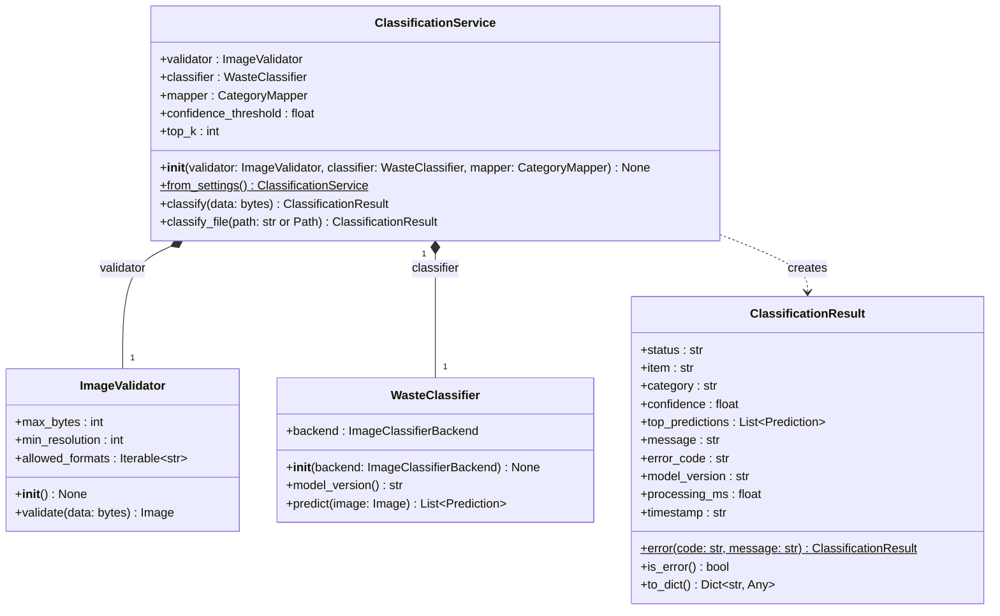
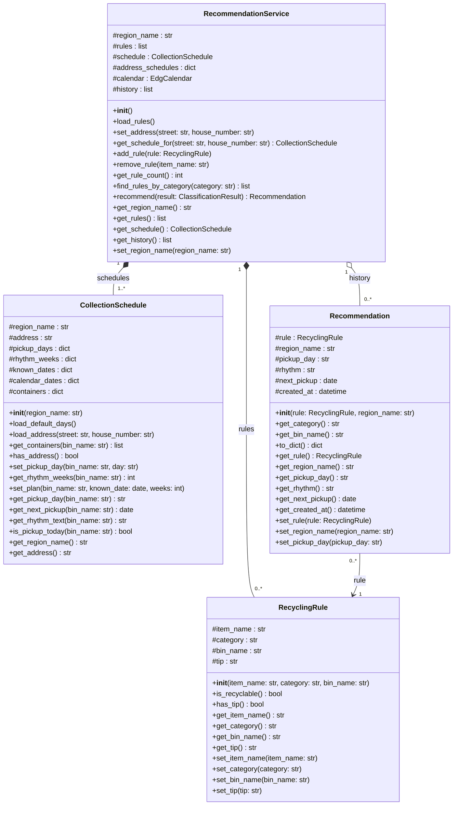
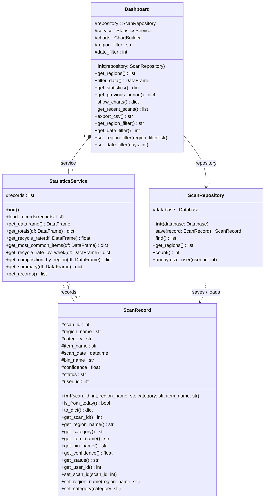

# AI-Powered Waste Sorting and Recycling Assistant

Capstone project, Python course 2026, FH Dortmund. **Group 27**, Topic 2.

A web app where citizens photograph a waste item and learn how to dispose of it. An AI model classifies the item
(recyclable, compostable or landfill), the app shows the local rules and collection days of Dortmund (EDG),
an OpenAI sustainability coach explains the decision, and the municipality gets a dashboard of what is thrown away.
The image model is [`watersplash/waste-classification`](https://huggingface.co/watersplash/waste-classification)
(a Vision Transformer fine-tuned on the Kaggle Garbage Classification dataset).

## Presentation and video

- Screencast (7 min): _add link here_
- Final presentation: _add link / file here_

## Team

| Member | Student ID | Subsystem |
|---|---|---|
| Amirhossein Owji | 7227410 | AI waste classification |
| Mahshid Jafari | 7227434 | Recycling recommendations |
| Ali Alagha | 7226045 | History and statistics, User interface and integration |

## How to start

Requirements: Docker and an OpenAI API key.

```bash
cp .env.example .env              # put your OPENAI_API_KEY into .env
docker compose up --build         # app + MySQL database
```

Open http://localhost:5050. Demo accounts (also a switch in the header):

| Role | Username | Password |
|---|---|---|
| Citizen | `citizen` | `citizen123` |
| Municipality | `city` | `city12345` |
| Admin | `admin` | `admin12345` |

Run the unit tests (32 tests, one file per subsystem):

```bash
docker compose exec app python -m pytest
```

## System design

Class diagram of each subsystem (main classes, their attributes and methods).

### AI waste classification (Amirhossein Owji)

Validates the uploaded photo, classifies it with the image model and returns the item, category, confidence, top 3 predictions and status (`ok`, `uncertain`, `error`).



### Recycling recommendations (Mahshid Jafari)

Turns the classification into the right bin and preparation tip (EDG rules) and reads the real collection days of the user's address from the EDG website.



### History and statistics (Ali Alagha)

Saves every scan in MySQL (no personal data) and calculates the dashboard statistics and charts with pandas and matplotlib (filters by region and date, CSV export).



### User interface and integration (Ali Alagha)

Flask web UI and REST API with roles (citizen, municipality, admin). The gateway sends every scan through the other subsystems and the OpenAI coach; accounts and sessions are handled by the account service.

```mermaid
classDiagram
    class ApiGateway {
        #database : Database
        #scans : ScanRepository
        #addresses : AddressDirectory
        #accounts : AccountService
        #classification : ClassificationService
        #recommendations : RecommendationService
        #coach : SustainabilityCoach
        #monitor : SystemMonitor
        +__init__()
        +setup()
        +set_calendar(calendar: EdgCalendar)
        +get_model_version() str
        +scan(token: str, image_bytes: bytes) dict
        +my_history(token: str) dict
        +my_schedule(token: str) dict
        +get_rules() list
        +ask_coach(token: str, question: str) dict
        +get_dashboard(token: str) Dashboard
        +dashboard(token: str) dict
        +dashboard_insights(token: str) dict
        +system_stats(token: str) dict
        +health() dict
    }
    class AccountService {
        #accounts : AccountRepository
        #scans : ScanRepository
        #addresses : AddressDirectory
        #sessions : dict
        +__init__(accounts: AccountRepository, scans: ScanRepository, addresses: AddressDirectory)
        +register(username: str, password: str, role: str, region_name: str) Account
        +ensure_account(username: str, password: str, role: str, region_name: str) Account
        +login(username: str, password: str) str
        +logout(token: str)
        +get_account(token: str) Account
        +require_admin(token: str)
        +update_profile(token: str, region_name: str) Account
        +change_password(token: str, old_password: str, new_password: str)
        +delete_account(token: str)
        +list_users(token: str) list
        +create_user(token: str, username: str, password: str, role: str, region_name: str) Account
        +change_role(token: str, user_id: int, role: str) Account
        +delete_user(token: str, user_id: int)
    }
    class Account {
        +ROLES : list$
        #user_id : int
        #username : str
        #password_hash : str
        #role : str
        #region_name : str
        #street : str
        #house_number : str
        #created_at : datetime
        +__init__(username: str, password: str, role: str, region_name: str)
        +set_password(password: str)
        +set_address(street: str, house_number: str)
        +check_password(password: str) bool
        +is_admin() bool
        +is_municipality() bool
        +has_address() bool
        +to_dict() dict
        +get_user_id() int
        +get_username() str
        +get_password_hash() str
        +get_role() str
        +get_region_name() str
        +get_street() str
    }
    class Session {
        +DEFAULT_MINUTES : int$
        #account : Account
        #minutes : int
        #token : str
        #expires_at : datetime
        +__init__(account: Account)
        +start()
        +is_expired() bool
        +extend()
        +end()
        +get_token() str
        +get_account() Account
        +set_expires_at(expires_at: datetime)
    }
    ApiGateway "1" *-- "1" AccountService : accounts
    AccountService "1" *-- "0..*" Session : sessions
    AccountService ..> Account : creates / loads
    Session "0..*" --> "1" Account : account
```


